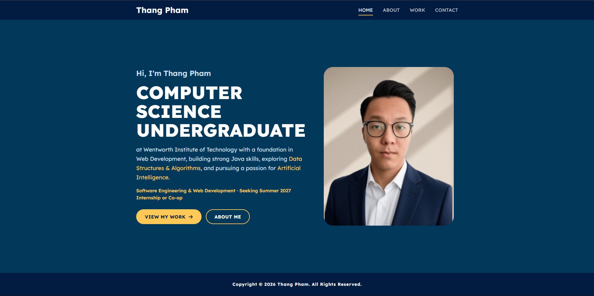

<div align="center">

# ✨ Thang Pham · Portfolio ✨

**Computer Science Undergraduate @ Wentworth Institute of Technology**
<br>
*Web Development · Java · Data Structures & Algorithms · Artificial Intelligence*

[](https://thang-h-pham.github.io/thangpham/)
[](https://www.linkedin.com/in/thanghpham/)
[](https://github.com/Thang-H-Pham)


<br>



</div>

---

## 👋 About

Hi, I'm **Thang Huu Pham**, a Computer Science sophomore at Wentworth Institute of Technology (Class of 2029), originally from Vietnam 🇻🇳.
This site is my corner of the web: who I am, what I've built, and how to reach me.

> 🎯 **Seeking a Summer 2027 Internship or Co-op** in Software Engineering & Web Development.

---

## 🗺️ What's Inside

| Page | What you'll find |
| :--- | :--- |
| 🏠 **Home** | A quick introduction and the roles I'm looking for |
| 🙋 **About** | My background, technical skills, certifications, resume, and LinkedIn |
| 💼 **Work** | My projects (Tic Tac Toe in Java, this portfolio) and experience at HackBoston & CodeWIT |
| ✉️ **Contact** | A working contact form that sends messages straight to my inbox |

---

## 🌟 Highlights

- 📱 **Mobile-first and fully responsive.** Tested at seven screen widths from 360px phones to 1920px desktops.
- 🍔 **Accessible navigation.** A hamburger menu on small screens that closes with <kbd>Esc</kbd>, plus `aria` labels and visible focus outlines.
- 📬 **Serverless contact form.** Built with EmailJS and client-side validation, so no backend is needed.
- 🎨 **Navy & gold design.** Lexend typography, a pulsing gold glow on photos, and support for `prefers-reduced-motion`.
- ⚡ **Zero build step.** Plain HTML, CSS, and JavaScript that loads fast and is easy to read.

---

## 🛠️ Built With

```
HTML5  ·  CSS3 (custom properties, clamp(), mobile-first media queries)
JavaScript  ·  EmailJS  ·  FontAwesome  ·  Google Fonts (Lexend)
GitHub Pages
```

---

## 📂 Project Structure

```
thangpham/
├── index.html        # 🏠 Home
├── about.html        # 🙋 About, skills, certifications
├── work.html         # 💼 Projects & experience
├── contact.html      # ✉️ Contact form
├── My_Resume.pdf     # 📄 Resume
├── style/            # 🎨 general.css + one stylesheet per page
├── js/               # ⚙️ nav, footer year, contact form
└── img/              # 🖼️ photos, skill icons, certificates
```

---

## 🚀 Run It Locally

No installs needed. Just clone it and serve:

```bash
git clone https://github.com/Thang-H-Pham/thangpham.git
cd thangpham
python -m http.server 8000
```

Then open **http://localhost:8000** in your browser.

---

<div align="center">

### 💛 Thanks for stopping by!

If you'd like to work together or just say hi, reach out through the [contact page](https://thang-h-pham.github.io/thangpham/contact.html) or on [LinkedIn](https://www.linkedin.com/in/thanghpham/).

<sub>© Thang Pham · All Rights Reserved</sub>

</div>
